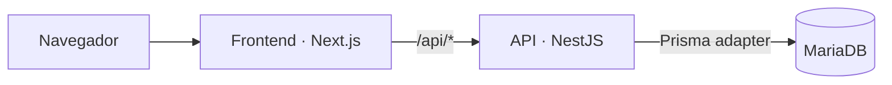

<div align="center">
  
  <h1>Beba Orange</h1>
  <p>Uma experiência digital para conhecer a Orange, criar uma conta e gerenciar clientes, planos e suporte.</p>
  <p>
    
    
    
    
    
  </p>
</div>

---

## Visão geral

O Orange é um monorepo com o site em Next.js, uma API NestJS e um banco MariaDB acessado via Prisma. O Docker Compose reúne os três serviços para desenvolvimento local.



## Começar com Docker

Requisitos: Docker Desktop com Compose v2, ou Docker Engine com o plugin Compose.

1. Copie o arquivo de exemplo:

   ```powershell
   Copy-Item .env.docker.example .env
   ```

2. Abra `.env` e troque a senha do administrador em `SEED_ADMIN_USERS`. Use uma senha com pelo menos 16 caracteres. Os valores de exemplo são apenas para desenvolvimento local.

3. Construa e inicie os serviços:

   ```powershell
   docker compose up --build -d
   ```

| Serviço | Endereço local |
| --- | --- |
| Site | <http://localhost:3000> |
| API | <http://localhost:4000/api/auth/status> |
| MariaDB | `127.0.0.1:3307` |

A API aplica as migrações pendentes e cria o administrador configurado ao iniciar. O banco fica no volume `orange_mariadb_data` e continua salvo depois de parar os containers.

> `docker compose down --volumes` apaga o banco local e todos os dados desse volume.

Veja o guia de [Docker Compose](DOCKER.md) para logs, SMTP/OAuth, persistência e detalhes de produção.

## Estrutura

```text
frontend/
├── src/app/             Páginas e rotas Next.js
├── src/components/      Componentes, formulários e painéis
├── src/lib/             Hooks e utilitários
├── src/styles/          Estilos do site e do painel
├── public/              Imagens, modelos 3D e arquivos públicos
└── Dockerfile           Imagem do site

backend/
├── src/auth/            Cadastro, login, OAuth e MFA
├── src/customers/       Operações de clientes
├── src/plans/           Operações de planos
├── src/support/         Atendimento e suporte
├── src/database/        Prisma, MariaDB e seed administrativo
├── prisma/              Schema e migrações
└── Dockerfile           Imagem da API

compose.yaml             Frontend, API e MariaDB para desenvolvimento
DOCKER.md                Guia de uso e operação dos containers
```

## Desenvolvimento sem Docker

Configure as dependências e o banco primeiro:

```powershell
npm --prefix frontend install
Copy-Item backend/.env.example backend/.env
npm --prefix backend install
npm run db:generate
npm run db:migrate
npm run db:seed
```

Edite `backend/.env` com a URL do MariaDB e os dados do administrador. Depois, inicie a API e o frontend em terminais separados:

```powershell
npm run api:dev
```

```powershell
npm run dev
```

Abra <http://localhost:3000>. No desenvolvimento local, o frontend encaminha as chamadas `/api/*` para a API na porta `4000`.

## Comandos úteis

| Comando | Ação |
| --- | --- |
| `npm run docker:up` | Constrói e inicia os serviços em segundo plano |
| `npm run docker:logs` | Acompanha os logs dos containers |
| `npm run docker:down` | Para os containers e preserva o volume do banco |
| `npm run dev` | Inicia o frontend fora do Docker |
| `npm run build` | Compila o frontend |
| `npm run api:dev` | Inicia a API em modo de desenvolvimento |
| `npm run api:build` | Compila a API |
| `npm run db:generate` | Gera o Prisma Client |
| `npm run db:migrate` | Aplica migrações pendentes manualmente |
| `npm run db:seed` | Cria os administradores configurados |

## Configuração e publicação

- `.env` e arquivos de credenciais são ignorados pelo Git. Nunca publique senhas ou chaves privadas.
- O Compose é voltado para desenvolvimento local. Para publicar na Hostinger, siga [DEPLOY-HOSTINGER.md](DEPLOY-HOSTINGER.md).
- Para detalhes específicos, consulte [frontend/README.md](frontend/README.md), [backend/README.md](backend/README.md) e [DOCKER.md](DOCKER.md).

> Preços e depoimentos da página inicial são demonstrativos. Recursos de clientes, planos e suporte dependem da API e do banco.
