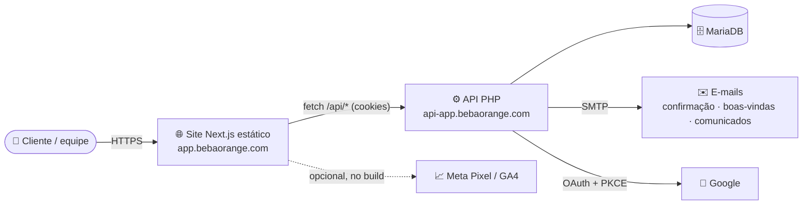

<div align="center">


# Orange

**Suco de laranja com colágeno, gelado, em Brasília: na garrafa que volta pra você.**

Site, contas de cliente, painel administrativo e API da Orange.

[](https://app.bebaorange.com)
[](https://api-app.bebaorange.com/api/health)


[Visão geral](#-visão-geral) ·
[Novidades](#-novidades) ·
[Rodando local](#-rodando-local) ·
[API](#-api) ·
[Deploy](#-deploy) ·
[Roadmap](#-roadmap)

</div>

---

## 🍊 Visão geral

Um **site estático em Next.js** e uma **API em PHP**, feitos para rodar em hospedagem compartilhada, sem Node.js em produção.



| | O que tem |
|---|---|
| **Site** | Página inicial com garrafa 3D, Sobre, Contato, Privacidade e Termos, servidor MCP público |
| **Contas** | Cadastro com confirmação por e-mail, login com Google, recuperação de senha, MFA (TOTP) opcional |
| **Central do cliente** | Dados da conta, chamados e mensagens com a equipe |
| **Painel adm** | Clientes, planos, chamados, comunicados por e-mail (modelos prontos ou **HTML próprio** com prévia e envio de teste) e teste de SMTP |
| **E-mails** | Confirmação com **cupom de 10%**, boas-vindas, redefinição de senha e descadastro em um clique |

---

## ✨ Novidades

### Novembro de 2026

- **E-mails dentro das regras da ANVISA.** O pôster de boas-vindas foi refeito e os textos dos e-mails não dizem mais "sem açúcar", "100% suco natural" nem "sem conservante", porque o produto tem colágeno. O HTML que gera o pôster fica em [`backend-php/email-assets/`](backend-php/email-assets/).
- **Cupom para quem entra com Google.** Contas criadas ou confirmadas pelo Google agora recebem o e-mail de boas-vindas com os 10% OFF, como no cadastro por e-mail.
- **MFA opcional.** Clientes que entram com Google vão direto para a Central, e o MFA continua disponível para quem quiser ativar.
- **Comunicados em HTML.** No painel dá para colar um layout HTML próprio, ver a prévia e mandar um teste para si mesmo antes de disparar.
- **Medição pronta.** O Pixel da Meta e o GA4 entram com eventos de `cadastro` e `compra`. Ficam desligados até os IDs serem definidos no build.
- **Repositório igual à produção.** Os e-mails que tinham sido editados direto no servidor agora estão no Git.

---

## 🗂️ Estrutura

```text
orange-site/
├── src/                  # 🌐 Site Next.js (o que vai para produção)
│   ├── app/              #    páginas: início, cadastro, login, central, admin…
│   ├── components/       #    interface, painéis, hero 3D, medição
│   ├── lib/              #    API client, analytics, hooks
│   └── styles/
├── public/               # imagens, modelos 3D (.glb), app web (Expo)
├── backend-php/          # ⚙️ API de produção
│   ├── src/              #    auth, OAuth, admin, suporte, comunicados, mailer
│   ├── email-assets/     #    fonte do pôster de e-mail (HTML → JPG)
│   ├── migrations/       #    SQL incremental
│   ├── tests/self-test.php
│   └── schema.sql
├── frontend/  backend/   # 🗃️ versões antigas (Node/NestJS), só como referência
└── out/                  # export estático gerado pelo build
```

> [!NOTE]
> Em produção, use apenas **`src/` + `public/`** (site) e **`backend-php/`** (API). As pastas `frontend/` e `backend/` são legado.

---

## 🚀 Rodando local

**Requisitos:** Node.js 20+, PHP 8.3+ com `pdo_mysql`, `openssl` e `mbstring`, e um MariaDB/MySQL local para testar a API completa.

```powershell
# Site
npm ci
npm run dev                      # http://localhost:3000

# API
cd backend-php
php -S localhost:4000            # o site usa essa porta em dev
```

### Build de produção

```powershell
$env:NEXT_PUBLIC_BACKEND_URL = "https://api-app.bebaorange.com"
npm run build                    # gera out/
```

<details>
<summary><b>📈 Medição: Meta Pixel e GA4</b></summary>

Como o site é estático, os IDs são lidos **no momento do build** e não pelo painel da Hostinger. Sem IDs, nenhum script externo é carregado.

```powershell
$env:NEXT_PUBLIC_META_PIXEL_ID = "123456789012345"
$env:NEXT_PUBLIC_GA_ID         = "G-XXXXXXXXXX"
npm run build
```

Também dá para usar `.env.production.local` (modelo em [`.env.example`](.env.example)).

| Evento | Quando | Meta | GA4 |
|---|---|---|---|
| `page_view` | toda troca de página | `PageView` | `page_view` |
| `cadastro` | cadastro por e-mail concluído | `CompleteRegistration` | `sign_up` |
| `compra` | chamar `trackCompra({ value, transactionId })` na página de obrigado | `Purchase` | `purchase` |

> No GA4, em *Fluxos de dados › Medição otimizada*, desligue **"Mudanças de página com base no histórico do navegador"**. Se ficar ligada, as visualizações contam em dobro.

Código: [`src/lib/analytics.ts`](src/lib/analytics.ts) e [`src/components/analytics.tsx`](src/components/analytics.tsx).

</details>

<details>
<summary><b>🔧 Configuração privada da API</b></summary>

O PHP não lê `.env`. Copie [`backend-php/config.example.php`](backend-php/config.example.php) para **`orange-config.php` fora do `public_html`** e preencha:

```text
DB_HOST / DB_PORT / DB_NAME / DB_USER / DB_PASSWORD
FRONTEND_URL=https://app.bebaorange.com
COOKIE_DOMAIN=.bebaorange.com
API_URL=https://api-app.bebaorange.com
SMTP_HOST / SMTP_PORT / SMTP_USER / SMTP_PASSWORD / SMTP_FROM
GOOGLE_CLIENT_ID / GOOGLE_CLIENT_SECRET
MFA_ENCRYPTION_KEY   # 32 bytes, nunca troque com MFA ativo
NODE_ENV=production
```

**Administrador inicial:** defina `SEED_ADMIN_USERS` (JSON) no arquivo privado, rode `php backend-php/seed-admin.php` uma vez e depois apague as credenciais.

**Google Cloud:** origem `https://app.bebaorange.com` e redirect `https://api-app.bebaorange.com/api/auth/oauth/google/callback`.

</details>

---

## 🔌 API

Base: `https://api-app.bebaorange.com`

<details>
<summary><b>Ver endpoints</b></summary>

| Método | Rota | Para quê |
|---|---|---|
| `GET` | `/api/health` | Saúde da API e do banco |
| `POST` | `/api/auth/register` | Cadastro (manda o e-mail de confirmação) |
| `POST` | `/api/auth/email/verify` · `/email/resend` | Confirmar e-mail / reenviar link |
| `POST` | `/api/auth/login` · `/logout` | Entrar / sair |
| `GET` | `/api/auth/me` | Sessão atual |
| `POST` | `/api/auth/password/forgot` · `/reset` | Redefinir senha |
| `POST` | `/api/auth/mfa/setup` · `/enable` · `/disable` · `/verify-login` | MFA |
| `GET` | `/api/auth/oauth/providers` · `/oauth/google` | Login com Google |
| `GET` `POST` | `/api/support/tickets` | Chamados do cliente |
| `GET` `PATCH` | `/api/admin/customers` | Clientes 🔒 |
| `GET` `POST` `PATCH` `DELETE` | `/api/admin/plans` | Planos 🔒 |
| `GET` `PATCH` | `/api/admin/operations/tickets` | Atendimento 🔒 |
| `GET` `POST` | `/api/admin/broadcasts` · `/preview` · `/test` · `/:id/send` | Comunicados 🔒 |
| `GET` | `/api/admin/smtp-check` | Diagnóstico de e-mail 🔒 |
| `POST` | `/mcp` | Servidor MCP público (só leitura) |

🔒 = exige sessão de administrador.

</details>

**Segurança:** senhas com `password_hash`, sessão em cookie `HttpOnly`, CORS limitado ao site, limite de tentativas no banco, OAuth com state, nonce e PKCE, e `src/`, `logs/` e `migrations/` bloqueados na web.

---

## 📦 Deploy

Os dois sites ficam na **Hostinger** (hospedagem compartilhada).

| Destino | O que publicar | Depois |
|---|---|---|
| `app.bebaorange.com` | conteúdo de **`out/`** (após `npm run build`) | abrir `/`, `/cadastro` e `/login` |
| `api-app.bebaorange.com` | conteúdo de **`backend-php/`** + pasta `email/` (imagens dos e-mails) | `GET /api/health` → `{"status":"ok"}` |

> [!WARNING]
> - O deploy **substitui o site inteiro**. Na API, leve junto a pasta `email/` com `poster-boas-vindas.jpg` e `gomo-acenando.png`.
> - Migrations rodam **à mão**, no phpMyAdmin, **depois de um backup**. A API nunca altera o banco sozinha.
> - Não edite arquivos direto no servidor. Mude no Git e publique, para produção e repositório não se separarem.

<details>
<summary><b>🧪 Checagens antes de publicar</b></summary>

```powershell
npx tsc --noEmit
npm run build
php backend-php/tests/self-test.php
Get-ChildItem backend-php -Filter *.php -Recurse | ForEach-Object { php -l $_.FullName }
```

</details>

---

## 🗺️ Roadmap

As prioridades ficam no Notion, em **Orange · Prioridades de programação**, ordenadas pelo impacto em vender logo.

- [ ] Erro do site ao abrir no celular
- [ ] Textos do site e planos novos (Campus, Plano 8, Plano 12, avulso) sem termos proibidos
- [ ] Pré-venda do Kit Founders com Pix/cartão
- [ ] Ativar Meta Pixel e GA4 com os IDs reais e aviso de cookies
- [ ] API do app (PHP): login por celular, assinatura, carteira e pagamentos
- [ ] Painel adm: cupons, exportar CSV, métricas de origem dos leads e pedidos da pré-venda
- [x] E-mails sem termos proibidos pela ANVISA
- [x] Cupom de boas-vindas para quem entra com Google
- [x] Comunicados com HTML próprio, prévia e teste

---

<div align="center">

Feito em Brasília 🍊 · © Orange. Consulte o proprietário antes de redistribuir ou usar comercialmente este código.

</div>
